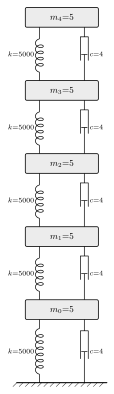
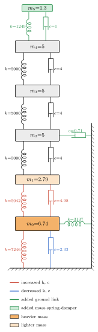
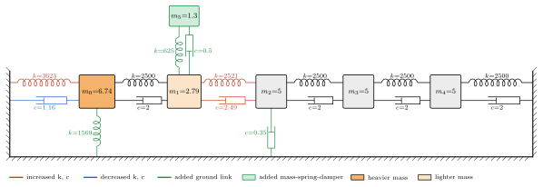
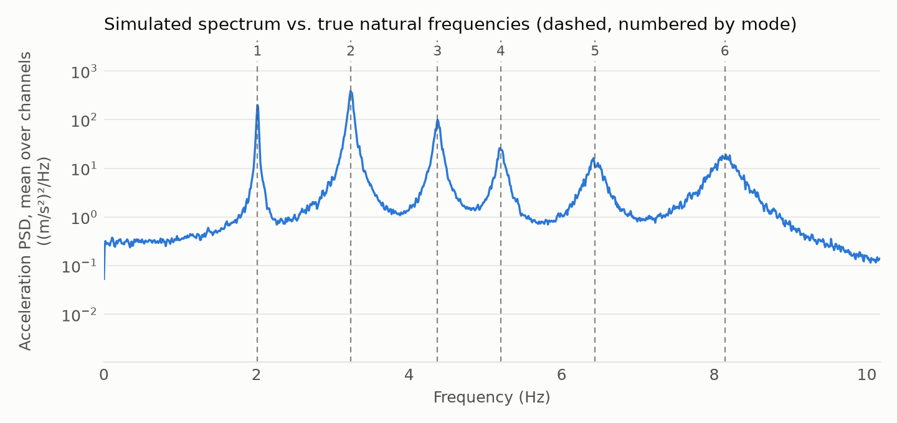

# dynsim

Randomised mass-spring-damper towers and chains with **ground-truth labels**, plus simulation tools and publication-style TikZ / SVG diagrams.

Build a baseline tower or chain, perturb it with randomised features (a stiffer link, an extra spring to ground, a heavier floor, an extra mass-spring-damper on top), and get back the matrices, the exact list of what was changed, and a diagram. Intended for generating benchmark systems for structural dynamics work: system identification, operational modal analysis (OMA) and structural health monitoring.

<table>
  <tr>
    <td align="center"></td>
    <td align="center"></td>
  </tr>
  <tr>
    <td align="center"><sub>Baseline tower</sub></td>
    <td align="center"><sub>Randomised tower (seed 111)</sub></td>
  </tr>
</table>




*Red / blue: stiffness and damping raised / lowered. Green: added ground spring, or added mass-spring-damper (outlined block). Orange: heavier / lighter mass.*

## Install

Not on PyPI yet. From GitHub:

```bash
uv add git+https://github.com/brandonjoconnell/dynamic-structures-simulator
# or
pip install git+https://github.com/brandonjoconnell/dynamic-structures-simulator
```

Requires Python 3.10+, numpy and scipy. **Diagrams as SVG** additionally need `pdflatex` (TeX Live / MiKTeX) plus one PDF-to-SVG converter: `pdf2svg`, `pdftocairo` (poppler) or `dvisvgm`. Generating the TikZ code (`to_tikz`, `write_tex`) needs neither.

## Quick start

```python
from dynsim import (AppendageSpec, GroundDamperSpec, GroundSpringSpec, ScaleConnectionSpec,
                    ScaleMassSpec, sample_system, render_svg)

rs = sample_system(
    111, "chain", 5,                      # seed, kind ("tower" or "chain"), number of floors
    feature_types=[
        ScaleConnectionSpec(n=2, k_range=(0.5, 2.0), c_range=(0.5, 2.0)),  # two connections: stiffness
                                          # and damping rescaled independently
        GroundSpringSpec(n=1),            # one spring to ground (no damper)
        GroundDamperSpec(n=1),            # one damper to ground (no spring)
        ScaleMassSpec(n=(1, 2)),          # rescale one or two masses
        AppendageSpec(attach="random"),   # attach an extra mass-spring-damper
    ],
)

print(*rs.describe(), sep="\n")           # the ground truth: exactly what was changed
# connection 2: k x1.01, c x1.25
# connection 0: k x1.45, c x0.582
# ground spring at floor 0: k=1569, c=0
# ground damper at floor 2: c=0.3532
# mass at floor 0: x1.35
# mass at floor 1: x0.558
# appendage on floor 1: m=1.303, k=624.7, c=0.4998

M, K, C = rs.system                       # 6x6 matrices (5 floors + 1 appendage)
rs.system.modal.wn                        # natural frequencies (Hz): 2.01, 3.24, 4.37, 5.20, 6.44, 8.14
render_svg(rs, "chain_111.svg")           # the diagram above
```

`rs` is a `RandomisedSystem`: `rs.system` (`SystemMatrices` with `M`, `K`, `C`), `rs.features` (the exact feature objects applied), `rs.connections`, `rs.kind`, `rs.ndof`. `build_system("tower", 6, features=[...])` builds a system from an explicit feature list, with no randomness.

Seeds reproduce the same system within one numpy version. numpy does not promise identical streams across versions, so keep `rs.features` if you need exact reproducibility later.

## Choosing what is randomised

Pass `feature_types` to say which kinds of change to include and how many. Use a name for default settings, or a spec object to customise:

```python
sample_system(42, "tower", 6)                                    # defaults: "scale", "ground", "mass"
sample_system(42, "tower", 6, feature_types=["scale", "mass"])   # no ground springs
sample_system(42, "tower", 6, feature_types=[])                  # the unmodified baseline
sample_system(42, "tower", 6, feature_types=[
    ScaleConnectionSpec(n=(1, 1), k_range=(0.25, 0.5)),          # exactly one link, 2x to 4x softer
    "appendage",                                                 # plus one mass on top
])
```

| Name | Spec | What it does | Defaults |
|---|---|---|---|
| `"scale"` | `ScaleConnectionSpec` | Multiplies the stiffness and/or damping of existing connections | `n=(0, 2)`; `k_range` and `c_range` as below (stiffness `(0.5, 2.0)` if you give neither); `couple_damping=False`; `targets=None` |
| `"ground"` | `GroundSpringSpec` | Adds springs to ground (spring only, no damper) | `n=(0, 2)`, `k_range=(0.1, 1.0)` × baseline connection stiffness, `couple_damping=False`, `targets=None` |
| `"ground_damper"` | `GroundDamperSpec` | Adds dampers to ground (damper only, no spring) | `n=(0, 2)`, `c_range=(0.1, 1.0)` × baseline connection damping, `targets=None` |
| `"mass"` | `ScaleMassSpec` | Multiplies the mass of some floors | `n=(0, 2)`, `factor_range=(0.5, 2.0)`, `targets=None` |
| `"appendage"` | `AppendageSpec` | Attaches a new mass (a new dof) to a floor through a spring and damper | `n=1`, `attach="top"`, `m_range=(0.1, 1.0)` × host mass, `k_range=(0.1, 1.0)` |

- **How many:** `n` is an inclusive `(min, max)` range, or an int for an exact count. `n=1` means exactly one, `n=0` means none. Counts are drawn per type and capped at what exists, and targets within one spec are distinct.
- **Ranges** are log-uniform, so the default `(0.5, 2.0)` makes softening and stiffening equally likely. A range with equal ends, such as `(2, 2)`, fixes the magnitude.
- **Where:** by default locations are random. `targets` restricts a spec to chosen connections (`ScaleConnectionSpec`) or floors (`GroundSpringSpec`, `GroundDamperSpec`, `ScaleMassSpec`), as an int or a list. With `targets` and no `n`, every target is changed; give `n` to pick a random subset of them. Magnitudes stay random within their range. (`AppendageSpec` uses `attach` for the same purpose.)
- **`"appendage"` and `"ground_damper"` are not in the defaults.** For an appendage, `attach` can be `"top"` (last floor), `"random"`, a floor index, or a list of indices to pick from.
- **Your own feature type:** any object with a `sample(rng, ctx) -> list[feature]` method works in `feature_types`; a feature needs `apply(conns, masses)` and `describe()`.

```python
sample_system(42, "tower", 6, feature_types=[
    ScaleConnectionSpec(targets=3, k_range=(0.3, 0.6)),        # soften connection 3, by 0.3-0.6x
    ScaleMassSpec(targets=[2, 4], factor_range=(2, 2)),        # double the mass of floors 2 and 4
    GroundSpringSpec(targets=[0, 5], n=1),                     # one ground spring, on floor 0 or 5
])
```

### Stiffness and damping

**Damping is never changed unless you ask for it.** Each spec changes only what you give it, so there is no hidden link between a stiffness change and a damping change:

```python
ScaleConnectionSpec(k_range=(0.5, 2))                       # stiffness only (also what you get with no arguments)
ScaleConnectionSpec(c_range=(0.5, 2))                       # damping only
ScaleConnectionSpec(k_range=(0.5, 2), c_range=(0.5, 2))     # both, drawn independently
ScaleConnectionSpec(k_range=(0.5, 2), couple_damping=True)  # damping gets the SAME factor as stiffness
GroundSpringSpec()                                          # a spring, no damper
GroundSpringSpec(couple_damping=True)                       # a spring plus a damper at the baseline c/k ratio
GroundDamperSpec()                                          # a damper, no spring
```

`couple_damping=True` is the one setting that makes damping follow stiffness, and it is opt-in. It cannot be combined with `c_range` (that raises a `ValueError`), and invalid ranges raise errors too. `describe()` and the diagrams always show exactly which of k and c changed. A spring and a damper added to the same floor are parallel elements and are drawn as one pair. Appendages are a mass-spring-damper, so `AppendageSpec` includes a damper by default; `couple_damping=False` removes it.

For fully explicit, non-random placement, pass features to `build_system` directly:
`build_system("tower", 6, features=[ScaleConnection(3, 0.5), ScaleMass(4, 1.5), AddGroundSpring(1, 800, 0.6)])`.

Connection indices (used by `ScaleConnection`, `targets` and shown in `describe()`): `0` joins ground to floor 0, `i` joins floor `i-1` to floor `i`, and in a chain the last index joins the top floor to ground.

## Diagrams

```python
from dynsim import to_tikz, write_tex, render_svg, render_batch

print(to_tikz(rs))                        # a tikzpicture to paste into your own document
write_tex(rs, "fig.tex")                  # a standalone .tex file
render_svg(rs, "fig.svg")                 # compile with pdflatex and convert to SVG
render_batch([sample_system(s, "tower", 4) for s in range(10)], "figs", stem="tower")
```

Options: `labels="none"` (no numbers), `legend=False`, `index_base=1` (number floors from 1). To use `to_tikz` output in your own LaTeX you need `\usepackage{tikz}` and `\usetikzlibrary{decorations.pathmorphing}`. Towers are drawn vertically, chains horizontally. Springs and dampers added to the same floor are parallel elements and are drawn as one pair; a spring with no damper (or a damper with no spring) is drawn without the missing symbol. The renderer supports at most one appendage per floor, attached to a baseline floor.

## Simulating and checking against the truth

`examples/simulate_and_check_modes.py` simulates accelerations of the randomised chain above under white-noise force and compares the spectrum with the exact natural frequencies:



The building blocks are `make_state_matrices`, `van_loan_discretisation`, `simulate_discrete_ssm` and `build_frf`. Run the example with `uv sync --extra examples` first (it needs matplotlib).

## Conventions and things to know

- **Units.** `SystemMatrices.modal` returns natural frequencies in **Hz**; `build_frf` and `poles_to_modal` use **rad/s**. Pass `2 * np.pi * modal.wn` to `build_frf`.
- **Tower baseline.** A tower connection has stiffness `2k` and damping `2c` (two spring-damper columns per storey, as in the original template); a chain connection has `k` and `c`. Diagram labels show these combined values.
- **Modes.** Local changes make damping non-proportional, so the true modes are complex. `.modal` returns real mode shapes (exact for proportional damping, a good approximation for light damping); `.modal_complex` returns the complex modes. Both are mass-normalised. Systems with overdamped or rigid-body modes raise a `ValueError`.
- **Appendages add dofs.** Appendage dofs come after the baseline ones; `rs.ndof` is the baseline floor count and `rs.system.ndof` includes appendages.
- **Behaviour changes from the original `simulator.py`:** `van_loan_discretisation` now always returns `(A, Q, Bd)` (`Bd` is `None` without `B`); `simulate_discrete_ssm` takes an `rng` argument and returns states and observations on the same time index (`y[:, t]` observes `x[:, t]`, previously the states were one step ahead); `make_state_matrices` raises on an unknown `observe`.

## Development

```bash
git clone https://github.com/brandonjoconnell/dynamic-structures-simulator
cd dynamic-structures-simulator
uv sync                          # creates .venv with the dev tools
uv run pytest                    # the LaTeX tests skip themselves if pdflatex is missing
uv run ruff check .
uv run python examples/make_gallery.py   # regenerate docs/img/*.svg
```

## Roadmap

Ideas rather than promises: nonlinear elements (Duffing, bilinear, gap) with a time-domain simulator; saving and loading ground-truth records as JSON; other topologies.

## Citing

See `CITATION.cff`.

## Licence

MIT, see `LICENSE`.
